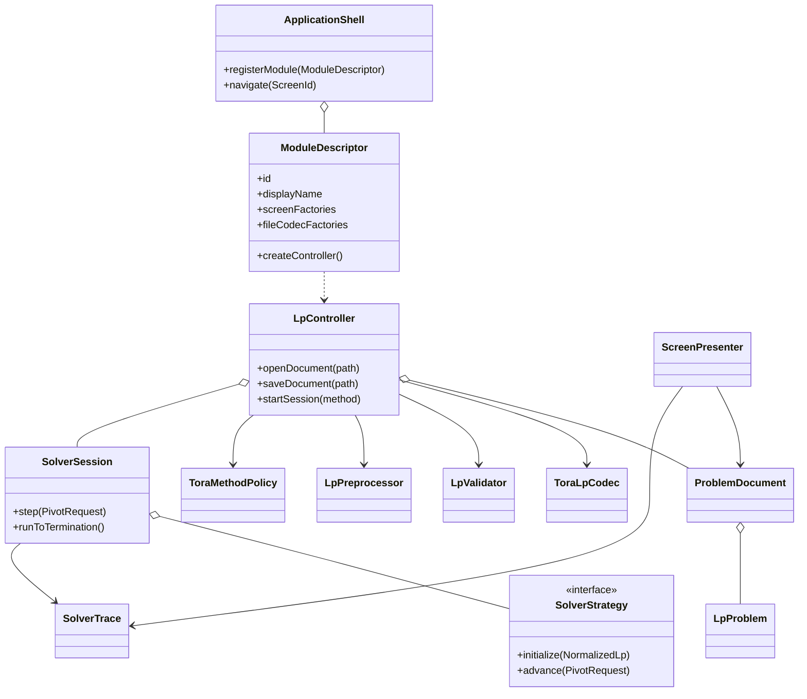
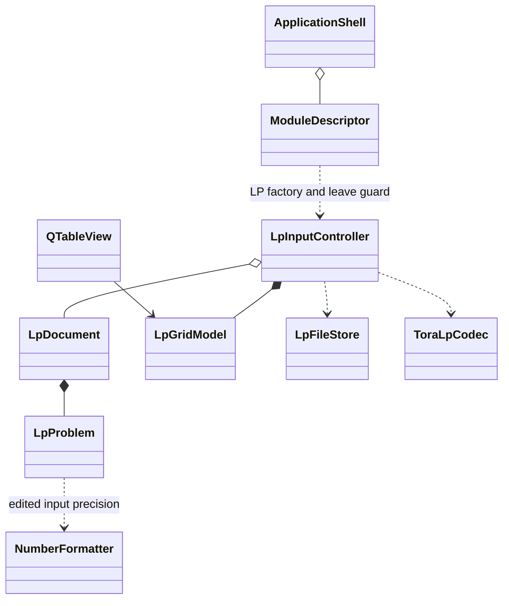

# Architecture approved at Gate 0

This document specifies the clone's design; class names do not describe TORA
internals. Gate 0 is approved. Foundation 1 implements the target boundaries
and native bootstrap. Foundation 5 implements the desktop shell before
Foundations 2, 3 and 4, following the user's approved order change. Foundation 2
implements the Qt-free numerical core. Foundation 3 implements the LP model
and validation. Foundation 4 implements the LP document, codec and file store.
Phase 2 adds the persistent LP input controller, native grid and file dialogs.

## Targets and dependency boundaries

Use C++17 or newer, CMake, and Qt 6 Widgets. `or_core` has no Qt dependency;
`or_lp` depends only on that core. `tora_compat` owns the observed LP text
format, method-selection warnings, display conventions, and compatibility
policies. `desktop_shell` supplies Qt screens, module registration, navigation,
file dialogs, and printing. The executable registers the LP module at startup.
Future modules can register with the same interface; this project implements LP
only. No HTML, browser runtime, or QtWebEngine dependency is permitted.

## Responsibilities

### Implemented desktop boundary (Foundation 5)

The following Foundation 5 description records the original shell boundary.
The implemented Phase 2 extension is described below; its input screen now
owns a real controller/model rather than preview-only fields.

`desktop_shell` is a static Qt Widgets library containing `ApplicationShell`,
`ModuleDescriptor`, `ScreenDescriptor` and the LP screen factories. A descriptor
provides an ID, display name, entry route and factories for content and menus.
The shell validates registrations, rejects duplicate IDs/routes and builds the
MAIN choices from registered descriptors. A test-only extension demonstrates
registration/navigation without changes to the shell or LP implementation.
No additional OR module is implemented. Controller/codec factories can be
captured by the screen factories once the later foundations supply them.

Pages are created lazily, retained in `QStackedWidget`, and wrapped in
`QScrollArea`. Routes do not create documents or solver sessions. Menus are
replaced on navigation; deletion is deferred until action dispatch finishes.
`lp_screens.cpp` provides screen frameworks only: no LP model, numerical
formatter, file codec, artificial tableau or fabricated solution.

`ApplicationShell` accepts optional `QSettings`, stores normal geometry and
maximized state, and bounds restored frames to individual available screens.
Screen-removal/available-geometry changes repair stranded windows; screen/DPI
and font events invalidate native layouts and repaint. All layouts use logical
coordinates and native/font-derived hints, including the notation count fields.
No screen-sized bitmap or raster UI cache is used. First interactive launch is
maximized; the window remains normally resizable/restorable.

Qt's Fusion widget style supplies a consistent classic presentation on all
OSes. This is the same Qt Widgets toolkit, with original colors/strokes and
text; no TORA resource is embedded. Malformed theme fonts are repaired at the
application level and after widget polishing, covering internal popup menus.
Valid preferences remain intact. Window preferences can be bypassed with
`--no-settings`; smoke tests never save them.

| Component | Responsibility |
| --- | --- |
| `ProblemDocument` | Model snapshot, source filename, read-only/dirty state, display settings, and preserved compatibility records |
| `LpProblem` | Objective direction and coefficients, named variables, bounds/sign flags, constraint relations and RHS values |
| `LpValidator` | Structural and numerical input diagnostics, with observed TORA messages where available |
| `LpPreprocessor` | Normalized model and an explicit mapping back to the input variables/rows; preserves ordering |
| `SolverStrategy` | One algorithm, numerical state, automatic pivots, user pivot requests, and termination |
| `SolverSession` | Step/All Iterations operation, cancellation, and immutable trace snapshots |
| `SolverTrace` | Every table, phase/iteration label, ordered columns/rows, basis, pivot colors, messages, and final/sensitivity data |
| `ToraMethodPolicy` | Observed method preconditions and redirections, separate from numerical arithmetic |
| `NumberFormatter` | Locale-independent decimal/scientific strings; rounding/width behavior established by oracle captures |
| `ToraLpCodec` | Byte-level parsing/writing, format diagnostics, and preservation of records whose semantics remain unknown |
| `LpController` | Document lifecycle, validation, method selection, session operations, and navigation |
| `ScreenPresenter` | Converts model/trace fields into display models without recalculating the solution |
| `PrintAdapter` | Native print preview/output using the same ordered display models |

Foundation 2 uses IEEE-754 binary64 for `Scalar`, value-owned
`DenseMatrix<Value>` storage, and a `Tableau` that performs only caller-requested
pivots. `Tolerance` makes absolute/relative comparisons explicit; its engineering
defaults are not asserted to be TORA thresholds. `NumberFormatter` is display-only
and locale-independent. See [numerical policy and evidence](tora-analysis/NUMERIC_FOUNDATION.md).
A rational solver backend is deferred: no verified Foundation 2 comparison
requires one. Wider matrix storage is available for later diagnostic work;
`long double` is not a portable guarantee of additional precision. Method-specific
zero, tie and termination policies remain requirements of the solver gates.
Do not silently substitute a mathematically preferred pivot or termination
rule for an observed TORA rule. Keep arithmetic results and the observed
presentation policy distinct so any confirmed legacy display anomalies have
narrow, testable compatibility handling.

## Class relationships

### Implemented LP model boundary (Foundation 3)

`or_lp` is a static C++17 library, publicly linked only to `tora::core`.
`LpProblem` stores original objective direction, coefficients, constraint
relations/RHS, variable aliases, finite or unrestricted negative-infinite lower bounds, finite/positive-infinite
upper bounds and independent unrestricted flags. All collections own their
values and retain input order. Aliases are distinct from generated x1/x2 labels.
`blank(n,m)` validates observed Student-version dimensions before allocation.

`LpValidator` returns ordered, located diagnostics without changing the model.
Each diagnostic distinguishes observed TORA wording from an engineering
safety rule. Validation checks structure and finite numbers; infeasible and
unbounded models are still valid inputs. It does not apply solver tolerances,
round numbers, normalize negative RHS values, split unrestricted variables or
construct a tableau. No Qt, codec or screen dependency enters this target.
Notation, source lexemes, read-only/dirty state and filenames belong to the
Foundation 4 document/codec boundary. See
[model policy and capture provenance](tora-analysis/LP_MODEL_VALIDATION.md).

### Implemented file boundary (Foundation 4)

`tora::compat` is a static C++17 library linked publicly to `tora::lp`, with no
Qt dependency. `LpDocument` implements the planned `ProblemDocument` role:
editable model/settings, source path, read-only mode, semantic dirty tracking,
saved checkpoints and original ordered records. `ToraLpCodec` parses and
serializes bytes independently of the filesystem. Unchanged fields retain
original lexemes; changed numerical fields serialize without display rounding.
Reserved cells and trailing records survive edits. Resizing with unknown
nonempty reserved grid data is rejected explicitly.

`LpFileStore` reads bounded binary data and prepares the complete saved
checkpoint before replacing a file via an exclusively created sibling
temporary. Windows wide-path and POSIX atomic replacement code is isolated in
one source file. Failed writes retain the document checkpoint and destination.
Read-only Save produces a typed redirect signal for the later controller;
Save As can create an editable copy, as observed in TORA. The later controller
owns native dialogs, confirmation and navigation; no widgets enter this library.

The user approved recovering TORA's doubled-quote records when TORA's own
reader corrupts them. Recovery is the default; explicit strict rejection is
available to callers. All other malformed-file safety messages are identified
as engineering diagnostics. See [file boundary specification](tora-analysis/LP_FILE_IO.md).

## Data flow and reproducibility

Opening a file produces a document and parsing diagnostics. Input edits produce
a new validated model snapshot. Choosing a method applies its compatibility
preconditions, normalizes that snapshot, and creates a solver session. Each
step appends a trace snapshot. Presenters consume snapshots for iteration,
final-summary, sensitivity, graph, and print views. Saving serializes the
input document, never a reconstructed model from the final tableau.

A trace must retain both unformatted values and the exact displayed strings,
plus the original row/column mapping. A golden fixture records the requested
method, actual method after redirection, format settings, user pivot choices,
all tables, and terminal messages. This prevents comparing only the optimum
or confusing an M-method selection redirected to All-Slack with an M trace.

Run-to-termination work can use a worker with queued Qt delivery of immutable
snapshots; widgets remain on the GUI thread. Cancellation must leave the last
complete iteration available. No OS-specific arithmetic paths are allowed.

## Module extension

A module supplies an identifier, display name, controller factory, document
model, solver implementations, codec factories, and screen factories. The
shell knows only registered descriptors and screen identifiers. Start with
compiled-in registration; a later Qt plugin adapter can expose the same
contract. Keep plugin ABI/version negotiation at that adapter boundary rather
than exposing STL-based domain types across an uncontrolled binary ABI.

Shared services are navigation, document prompts, preferences, native dialogs,
printing, and capture/testing adapters. LP-specific models, normalization,
solvers, graphical geometry, and text records stay within the LP module.

## Native layout and display policy

Use `QMainWindow`, layout-managed widgets, a screen stack, `QTableView` models,
and splitters/scroll areas. Draw graphical solutions using `QPainter` or a
`QGraphicsView`. Preserve observed panel order and labels while allowing the
native window to resize. Measure table/button sizes using current font metrics;
logical sizes must not be derived from the oracle's 800×600 coordinates.

Use Qt 6's high-DPI behavior and device-independent coordinates. React to screen,
font, and device-pixel-ratio changes; invalidate raster caches and rebuild
painter resources as necessary. Persist window geometry with a screen-bound
sanity check so unplugging a monitor cannot strand the window. Verify 1366×768
through 4K, scaling at 100/125/150/200%, and moving between monitors. Where the
logical viewport is small, scrolling must preserve access to every control.

## Build, tests, and packaging

Use one source tree and one GitHub Actions workflow with an OS matrix of
`windows-latest`, `ubuntu-latest`, and `macos-latest`. Each job builds and runs
core, codec, and relevant GUI tests. Packaging is the primary OS-specific step:
Windows portable deployment with `windeployqt` and an installer if practical;
Linux AppImage; macOS `.app` in `.dmg`. Assess universal arm64/x86_64 support
against the selected Qt distribution in Foundation 1. Do not promise a single
Windows executable by bundling through unsupported extraction hacks.

Core tests are headless and consume approved transcriptions. GUI tests verify
bindings, navigation, and accessibility of controls; visual reviews compare
layout and highlighted states. Raw proprietary captures and TORA binaries are
excluded from public source/release artifacts until the user approves specific
reference material. Release artifacts contain the clone and its dependencies.

## Decisions still dependent on observation

The successful codec schema, displayed tie rules, and complete numeric trace
coverage are established by captures. Hidden numerical thresholds, remaining
format limits, and successful printing still need observation. They are
tracked in `OPEN_QUESTIONS.md`; this architecture provides boundaries for
resolving them without guessing implementation behavior.

## Implemented Phase 2 input boundary

LpInputController is a persistent QObject parented to ApplicationShell, shared
by lazy LP route factories. It owns an optional LpDocument, LpGridModel, typed
row/column clipboard and injectable dialog services. The native delegate
commits Return/Tab through editable cells; imported spellings remain cached.
Cell changes go through ToraLpCodec::setGridText on a candidate document, then
notify the view. Shape changes preserve unrelated fields and saved metadata.
File dialogs convert Unicode filenames independently of legacy text bytes.

ModuleDescriptor::beforeLeave is a generic callback taking shell/from/to.
ApplicationShell invokes it before route changes/window close; a false result
keeps the route/window. The LP callback commits editors, validates SOLVE input
and runs Save?. The shell does not acquire a domain dependency. No solver
session is created by editing/saving. These are the implemented relationships:

Windows-1252 conversion is a desktop boundary; the Qt-free codec retains raw
legacy bytes. The input support profile extends to N/D=99 after direct oracle
captures. Safe diagnostics do not reproduce N=999 overflow/process exit.
